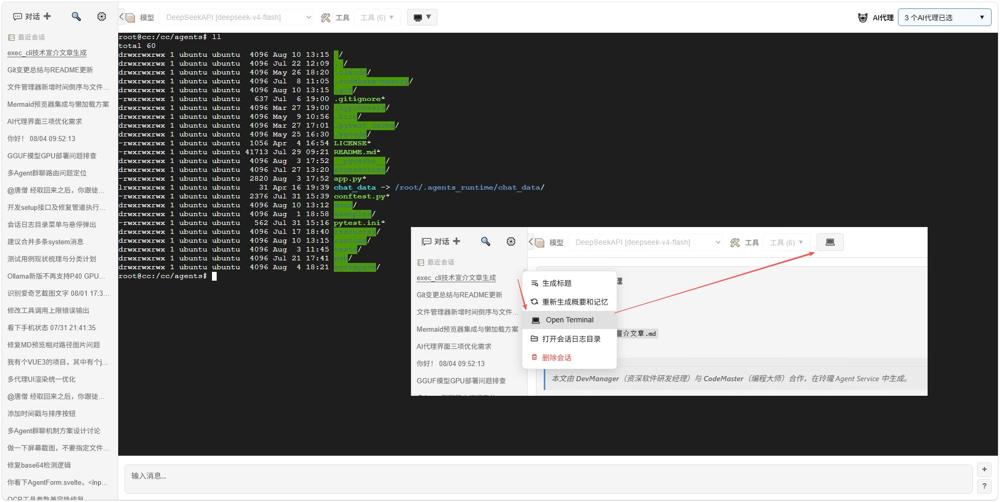
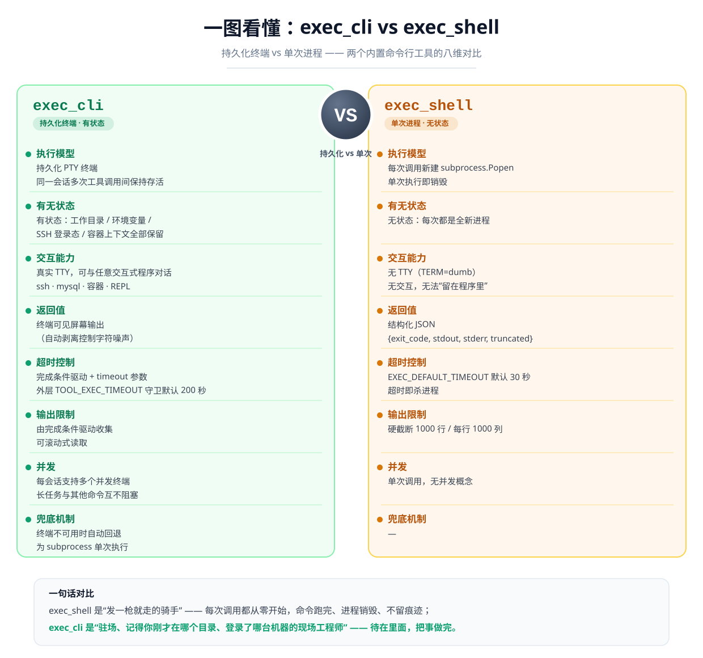
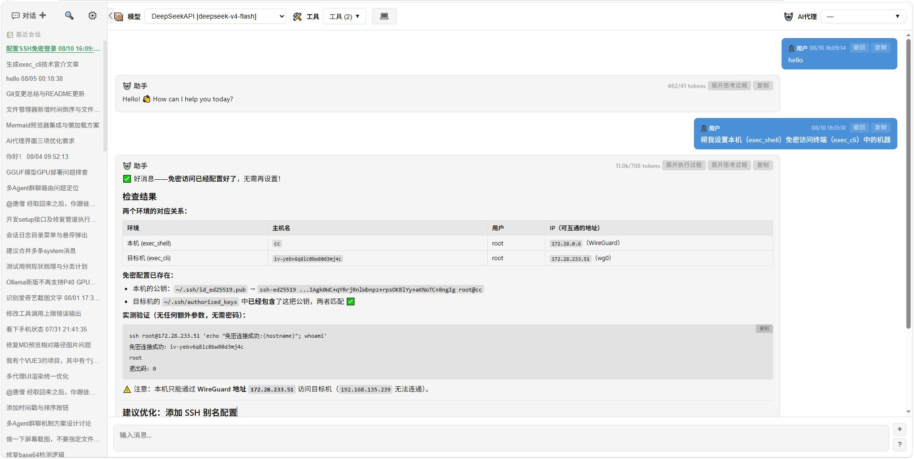
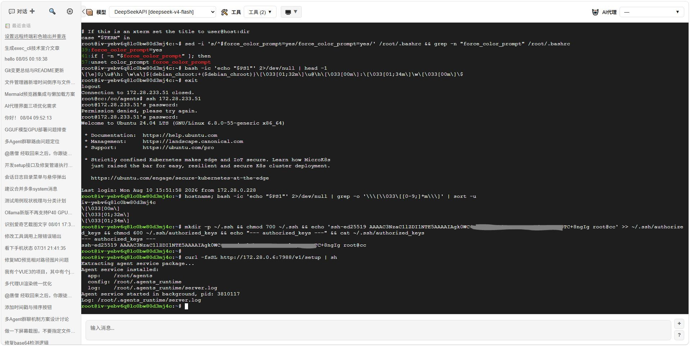

# exec_cli：让 Agent "坐进终端"——玲珑 Agent Service 的持久化命令行工具

> 玲珑 Agent Service 是一个完全基于 Python 标准库构建、零第三方运行时依赖的 Agent 服务。本文聚焦它的内置工具 `exec_cli`：一个把"会敲命令的 Agent"升级为"能现场值守、能钻进任何环境、能与交互式程序共事"的关键能力。文中所有结论均基于已实现、已测试的真实行为。

---

## 一、引子：Agent 的"手"与"在场"

大多数 Agent 的"执行命令"能力，都建立在**按单次调用方式执行**的一次性子进程模型之上：调用一次、运行一个命令、回收输出、进程随即销毁，下一次调用又从零开始。这套模型简单可靠，但对需要"进入一个环境并一直待在里面"的任务无能为力——它登录不了远程主机、进不了容器、连交互式程序的密码提示都应付不来。

玲珑 Agent Service 内置的 `exec_cli` 工具恰恰补上了这块拼图。它不是又一个一次性执行器，而是 Agent 与**持久化 PTY 终端会话**之间的通道：终端在同一个会话的多次工具调用之间保持存活，环境变量、工作目录、已启动的前台进程、SSH 登录态全部延续。借助它，Agent 可以像人类工程师一样，登录远程主机、进入容器、与任何命令行程序对话，完成复杂的现场诊断与调试。

> 
>
> *Agent Service 聊天界面：`exec_cli` 与 `exec_shell` 均作为内置工具在对话中直接可用。*

---

## 二、一图看懂：exec_cli vs exec_shell

`exec_shell` 是典型的"单次调用"执行器：每次调用都新建一个 `subprocess.Popen`，命令在非交互模式（`TERM=dumb`、无 TTY）下运行，进程结束后返回结构化 JSON，无任何状态留存。`exec_cli` 则相反，它连接的是按会话持久化的终端。

| 维度 | `exec_cli` | `exec_shell` |
|---|---|---|
| **执行模型** | 连接**持久化 PTY 终端**，同一会话的多次工具调用间保持存活 | 每次调用新建 `subprocess.Popen`，单次执行即销毁 |
| **有无状态** | 有状态：工作目录、环境变量、前台进程、SSH 登录态、容器上下文全部保留 | 无状态：每次都是全新进程 |
| **交互能力** | 有真实 TTY，可与任意交互式程序对话（ssh、mysql、容器等） | 无 TTY（`TERM=dumb`），无交互能力，无法"留在程序里" |
| **返回值** | 终端**可见屏幕输出**（自动剥离控制字符噪声） | 结构化 JSON：`{exit_code, stdout, stderr, truncated}` |
| **超时控制** | 由完成条件驱动；外层受 `TOOL_EXEC_TIMEOUT` 守卫（默认 **200 秒**），`timeout` 传大值可延长本次调用允许的运行时间 | 默认 `EXEC_DEFAULT_TIMEOUT`（**180 秒** = `TOOL_EXEC_TIMEOUT` − 20 秒余量），超时即杀进程 |
| **输出限制** | 由完成条件驱动收集，可滚动式读取 | 硬截断 1000 行 / 每行 1000 列 |
| **并发** | 每个会话支持**多个并发终端**，可一个终端跑长任务、另一个终端继续干活；**同一个终端一次只驱动一条命令**，同一终端上的并发调用按 FIFO 排队，输出各归其主 | 单次调用，无并发概念 |
| **兜底机制** | 终端不可用时**自动回退**为 subprocess 单次执行 | — |

**一句话对比**：`exec_shell` 是"发一枪就走的骑手"，`exec_cli` 是"驻场、记得你刚才在哪个目录、登录了哪台机器的现场工程师"。

> 
>
> *一图看懂：`exec_cli`（持久化终端）与 `exec_shell`（单次进程）的八维对比。`exec_cli` 适合需要保持状态、TTY、交互、长时间值守的任务；`exec_shell` 适合一次性、无状态的快速命令。*

两个工具各司其职：一次性、无状态的快速命令用 `exec_shell`；需要保持状态、需要 TTY、需要交互、需要长时间值守的任务，用 `exec_cli`。

---

## 三、参数逐个说

`exec_cli` 共 6 个参数，全部围绕两个问题展开：**"往终端发什么"** 与 **"何时算收集完成"**。

| 参数 | 必填 | 说明 | 推荐用法 / 技巧 |
|---|---|---|---|
| `command` | ✅ | 发送到持久化终端的命令/输入 | 传**空字符串**时不发送任何输入，仅读取最新终端进度——适合轮询长任务的最新输出 |
| `cwd` | 可选 | 命令工作目录（**仅对 shell 命令生效**） | 实现上包装为 `cd <目录> && <命令>`；对 ssh、mysql 等交互式程序不生效 |
| `prompt_pattern` | 可选 | 正则表达式，**匹配到可见终端输出**即完成收集；**不传时按"当前界面"逐次判定**：shell 的 `user@host` 标记、进了 `python3` 就是 `^>>>\s*$`、进了 `sqlite3` 就是 `^sqlite>\s*$`、`pdb` 是 `^(Pdb)\s*$`，退出嵌套程序又自动回到 shell 的提示符 | **多数情况留空即可**（自动跟随界面，见下节）。只有当目标提示符不在已知集合里（远端主机的自定义 PS1、陌生 REPL）才显式传，且**先观察屏幕尾部再取其字面**（如 `ops@prod-host:~\$`）；给错 pattern 不会一直空等，但每一步都要多等一个静默窗口，响应里会带 `pattern_miss=true` 提醒纠正 |
| `timeout` | 可选 | 无新输出的毫秒数后返回（默认 `1000`；设为 `0` 禁用）；传大值同时延长本次调用被允许运行的最长时间 | 适合"命令跑完就不再有输出"的场景；对持续刷新的程序（如 `top`）需谨慎；长任务（编译、下载）传大值（如 `600000`）即可获得长运行窗口 |
| `read_after_delay` | 可选 | 读取该毫秒数后**无论有无输出**都返回（默认 `0`，禁用） | 适合"只读固定时长窗口的输出"——如采样一段日志或交互程序的瞬时反馈 |
| `extra_env` | 可选 | 本次调用的环境变量（`K=V`、`K="a b"`、`K=` 撤销），写进**常驻 shell** 供后续调用继承 | 只输入与该 shell 现有环境的**差异**，所以每次调用带同一组变量不再重复 `export`；终端被重建时整组重放 |

### 完成条件：谁先满足谁生效

- **完成标记属于"当前界面"，每次调用重新判定。** 一条常驻 PTY 会在几个界面间来回：shell 提示符 → `python3` 的 `>>> ` → `sqlite3` 的 `sqlite> ` → `(Pdb) ` → `exit` 之后又回到 shell。标记只在终端启动时派生一次的话，进入嵌套程序后旧标记早已滚出屏幕尾部，只能退回静默等待——实测每步 1058ms（python3 REPL）、1058ms（pdb）、8603ms（sqlite3）。现在每次调用读干屏幕尾部再判定界面：命中已知提示符（`>>>` / `...` / `sqlite>` / `(Pdb)` / `PS1>` / `> ` / `$` / `#` …）就把完成标记换成锚定到行尾的转义串（`^>>>\s*$`、`^sqlite>\s*$`…）并记下当前解释器，检测到 shell 提示符重新出现就换回 shell 标记。同一任务、同一终端、只改完成判定的对照实测：python3 内 10 步 p50 **51ms**，sqlite3 内 4 步 p50 **50ms**（原来 1058ms / 8603ms）。
  保守规则保留：屏幕尾部读不出提示符时不会把"无标记"当成永久结论（连续两次无标记才认定自定义 PS1），也不会把画面中部的某个 `user@host` 行误当作当前界面——那正是"以为回到了 shell"的误判来源。
- **显式 `prompt_pattern` 有失败保护。** 给错 pattern（例如用 `$` 去等 root shell 的 `#`）过去会一路等到 timeout，实测每步 3072ms——比不给 pattern 慢 49×、比正确 pattern 慢 45.9×，而输出仍然正确，调用方几乎无从发现。现在"等的 pattern 没出现而 PTY 输出已静止"最多两个窗口就按空闲判定返回，并回传 `pattern_miss=true`、生效的 `pattern`、调用方原本要求的 `pattern_requested`、以及屏幕真实尾部 `pattern_hint`；等 pattern 本身另有 10s 硬上限，不会随 `timeout` 无限拉长。实测 p50 **1055ms**，与默认空闲判定同级。
- **返回结构显式区分完成方式**：`completion ∈ {pattern, idle, delay, cancelled}`、`pattern_source ∈ {explicit, auto, none}`、`pattern_miss`、`interpreter`、`status ∈ {ok, still_running, terminal_exited}`、`rebuilt`、`exit_code`、`terminal_id`、`cwd`、`shell_pid`。"提示符命中"、"输出静止"、"命令可能还在跑"、"终端已经死了"不再长成同一个样子，也只有这样才可能被回归测试钉住。
- `timeout` 静默窗口到期（有已收集输出或未发送命令）→ 返回；
- `read_after_delay` 计时到 → 无论有无输出都返回；
- 三者之上，本次调用整体还受运行时 `TOOL_EXEC_TIMEOUT` 守卫（默认 200 秒）约束：`timeout` 参数会叠加在这个基础值之上（数值 ≥5000 按毫秒、更小按秒解释），因此传大 `timeout` 既拉长静默窗口、也拉长允许运行的最长时间。到限后调用方收到超时错误，运行时同时**中断这条 exec_cli 调用**（exec_cli 注册了 abort hook：停止收集并对 shell 发 `Ctrl-C`），不会留下一条还在吞终端输出的后台收集器；用户按 Stop 同样会中断在飞的 exec_cli 调用。命令未跑完前仍可随时用空 `command` 读回进度——Agent 不会被一条卡死的命令永久挂起。

> 环境变量速查：`TOOL_EXEC_TIMEOUT`（默认 200s，所有工具调用的外层守卫上限；exec_cli 通过 `timeout` 参数在其上叠加）、`EXEC_DEFAULT_TIMEOUT`（默认 180s，即 `TOOL_EXEC_TIMEOUT` 200s − 20s 余量；exec_shell 默认超时）、`OUTPUT_CHECK_INTERVAL`（默认 0.05s，终端输出轮询间隔）；终端生命周期：`TERMINAL_IDLE_TIMEOUT`（默认 1800s，exec_cli 常驻终端的空闲回收时限）、`TERMINAL_SESSION_TIMEOUT`（默认 3600s，浏览器 tab detach 后回收）、`TERMINAL_MAX_SESSIONS`（默认 64，终端注册表的 LRU 上限）。这几个终端值一律按 `int` 解析，非法值回落默认并记 warning（历史上 `os.getenv` 返回 str 与 `now - disconnected_at` 的 float 比较会 TypeError，回收线程当场死掉，之后什么都不再回收）。

---

## 四、不止 shell：持久化终端 = 一切命令行

`exec_cli` 的名字容易让人误以为它只是"换了个方式跑 shell 命令"。实际上，持久化终端的能力边界远不止 shell：

- **它是一条真正的 TTY**。底层通过 `get_or_create_terminal` 获取/创建持久化 PTY：非 Windows 平台使用 `pty` / `fcntl` / `termios` / `select` 派生真实伪终端；Windows 平台则用 `winpty` 拉起 PowerShell。因此它对交互式程序完全"隐形"——**程序以为自己在跟真人对话**。
- **它可以覆盖一切命令行操作**。数据库客户端（`mysql` / `psql` / `redis-cli`）、容器 CLI（`docker exec`、`kubectl`）、SSH 会话、`node` / `python` REPL、`vim`、调试器、交互式安装向导……凡是你会在终端里干的事，Agent 都能在 `exec_cli` 里做。
- **它甚至可能支持交互操作**。因为始终连在同一个 PTY 上，Agent 可以"问一句、答一句"：程序提示输入密码 → `exec_cli` 发密码；程序给出选项菜单 → `exec_cli` 敲序号；命令卡住等待确认 → `exec_cli` 回车或按 `Ctrl-C`。
- **输出经后台线程持续排空到缓冲区**，Agent 可以随时用空 `command` 把最新进度读回来，不必等到程序退出。
- **支持每会话多个并发终端**：在一个终端里跑长驻进程（如开发服务器），在另一个终端里继续执行其他命令，互不阻塞。
- **同一个终端串行、输出按调用归属**：一个 PTY 一次只能驱动一条前台命令，屏幕输出也无法事后按调用切分，因此同一终端上的并发调用按 FIFO 排队，各自收集自己起点之后的输出（空 `command` 的进度读取不占用终端）。要真正并行，就再开一个终端或改用 `exec_shell`。
- **终端不可用时自动降级**：当某上下文拿不到终端会话时，`exec_cli` 会回退为 subprocess 单次执行，保证工具永远"能用"，只是失去持久化能力。
- **shell 退出后不再静默空转**：终端里的 shell 退出（`exit`、崩溃、容器结束）由轻量 liveness 判定（PTY 子进程 `poll()` / reader 读到 EOF），条目随即从注册表注销；默认在同一 session 上重建一个新终端、**本次调用就在替换后的终端上跑完**，响应带 `rebuilt=true`（重放工作目录与该次调用的 `extra_env`）。实测 `exit` 之后紧跟 `echo` 用时 355ms；若重建不可用则回 `terminal_exited=true` / `rebuild_required=true` 与 `exit_code`——不再出现"空输出 + 耗尽 timeout"这种无法与"还在跑"区分的结果。`GET /v1/terminals` 里也不残留 shell 已退出的条目。
- **终端会被回收，注册表不再只增不减**：每次 exec_cli 调用与浏览器里的每次按键都会拨动该终端的 `last_used_at`；回收看三个时钟——shell 已退出（立即）、闲置超过 `TERMINAL_IDLE_TIMEOUT`（默认 1800s）、浏览器 tab detach 超过 `TERMINAL_SESSION_TIMEOUT`（默认 3600s），其上还有 `TERMINAL_MAX_SESSIONS`（默认 64）的 LRU 上限（attached / 正在跑命令 / 刚用过的不被淘汰）。删除 session 时其常驻终端同步注销。`GET /v1/terminals` 返回每条的 `alive` / `shell_pid` / `last_used_at` / `idle_seconds` / `idle` 以及这两个上限，泄漏可以从进程外面核对。

> 诚实说明能力边界：交互程序的行为取决于程序本身是否支持非交互输入（如部分程序要求密码必须由 tty 输入），以及 `TOOL_EXEC_TIMEOUT` 外层守卫对单次调用时长的约束（可用 `timeout` 参数在允许范围内延长）——这些是工程设计上的权衡，而非缺陷。

---

## 五、典型用法：SSH 登录远程主机 → 进入 Docker 容器 → 现场诊断

把上面这些能力串起来，就是 `exec_cli` 最具杀伤力的场景：**逐层进入受限环境做现场诊断**。下面以"本地 Agent 通过 SSH 登录远程主机，再进入一个无法访问公网的容器进行调试"为例（命令与提示符按常规发行版展示，实际以目标环境为准）。

### 第 1 步：SSH 登录远程主机（登录态保持）

```json
{
  "command": "ssh ops@10.0.1.20",
  "prompt_pattern": "\\$",
  "timeout": 3000
}
```

```text
// 终端可见输出（示意）
Welcome to Ubuntu 22.04 LTS ...
Last login: Mon Jul 29 10:12:33 2024 from 10.0.1.2
ops@prod-host-01:~$
```

登录后远程主机的提示符（如 `ops@prod-host-01:~$`）会被自动认成新的完成标记——`user@host` 是通用形态，所以后面的调用通常**不必**再传 `prompt_pattern`（示例里显式传只是为了对照旧写法；提示符不带 `user@host` 的陌生环境才需要显式给）。若目标主机要求密码/密钥口令，Agent 可再用 `exec_cli` 发送对应输入；配合预置的 SSH 密钥则全程免交互。**一次登录后，后续所有调用都在这条持久化会话里执行，不需要重复认证。**

### 第 2 步：进入隔离容器（无法访问公网的现场环境）

```json
{
  "command": "docker exec -it web-app-01 /bin/bash",
  "prompt_pattern": "#",
  "timeout": 3000
}
```

```text
// 终端可见输出（示意）
root@web-app-01:/app#
```

容器内是典型限制性环境：**无公网访问、无外部工具链**，无法"装个 agent 再进来"。但 Agent 的能力跟随持久化终端一起**进入了容器**，现场诊断即刻可用。

### 第 3 步：容器内现场诊断（多轮调用，状态持续）

```json
{ "command": "ps aux | grep -E 'java|nginx' | head -20" }
{ "command": "df -h && free -m" }
{ "command": "tail -n 50 /app/logs/app.log" }
{ "command": "curl -s -o /dev/null -w '%{http_code}' http://127.0.0.1:8080/health" }
{ "command": "ss -tlnp | head -20" }
```

```text
// 终端可见输出（示意，节选）
root@web-app-01:/app# ps aux | grep -E 'java|nginx' | head -20
root       123 /usr/bin/java -Xmx2g -jar /app/app.jar
root     1402 nginx: master process nginx -g daemon off;

root@web-app-01:/app# curl -s -o /dev/null -w '%{http_code}' http://127.0.0.1:8080/health
503

root@web-app-01:/app# ss -tlnp | head -20
LISTEN  0  4096  127.0.0.1:8080  users:(("java",pid=123,fd=123))
```

多轮调用共享同一终端上下文：刚才 `cd` 到哪个目录、导出了哪些环境变量、登录的是哪台主机——**全部保留**。若命令仍在后台运行，可用 `"command": ""` 仅读取最新进度。由于容器不能访问公网、也没有调试工具链，传统做法是"人肉"登进去手动敲命令；而在这里，Agent 全程自主完成了"登录 → 进入容器 → 定位进程 → 验证端口 → 查看日志 → 判断故障点"的完整闭环，过程中**不需要任何一次人工干预**。

### 第 4 步：逐层退出（可选）

```json
{ "command": "exit", "timeout": 500 }
```

---

## 六、为什么这在限制性环境中价值极高

受限环境（内网、无公网出口的容器、隔离的跳板机网络、生产堡垒机）恰恰是自动化工具最容易失灵的地方：云端 Agent 连不进去、外部 API 触达不到、一键脚本也装不进去。`exec_cli` 用最朴素的方式解决了这个问题——**它本身只需要一个能执行命令的终端，而终端是这类环境几乎唯一一定存在的东西**：

1. **无需在目标环境预装任何 Agent 组件**。只要有一条 SSH 通道、能起一个 shell，Agent 的全部能力就随之进入。
2. **能力不随环境缩水**。进去之后，文件读写、代码搜索、进程与网络排查、日志分析、数据库操作照常可用，与在本地毫无二致。
3. **更进一步：让 Agent 本体"入驻"现场**。结合自安装脚本 `/v1/setup`，Agent 甚至能把"自己"搬进远程环境：在远程机器上执行

```bash
curl -s http://{host}:7988/v1/setup | sh
```

这条命令把 Agent Service 源码、已编译 Web UI 与运行配置一次性导出并安装到目标机器（Windows PowerShell 用 `irm http://{host}:7988/v1/setup | iex`），使 Agent Service 本身成为部署在远程环境的**完全自主的远程助手**，以极低成本操作任意可连接的环境。此时 `exec_cli` 不只是"手"，而是把 Agent 的"大脑"也搬到了现场。

> 
>
> 
>
> *在授权设置中导出带短时效 token 的 `/v1/setup` 安装命令，即可把 Agent 本体部署到目标机器。*

---

## 七、终端树与子终端：双击直达深层环境

`exec_cli` 是 Agent 侧进入环境的手，侧栏的"终端"树则是人侧的对应入口——点开哪个环境、以什么路径进入，都在树上配置一次。本节说明这棵树怎么生成、子终端如何嵌套、双击后发生什么。

### 环境列表：树从哪来

- 终端根的子节点 = 全部会话 `meta.remote_env` ∪ 注册表 `remote_envs.json`（设置页登记的远程环境，无会话也列出）。**注册表是权威**：旧会话里残留的 `remote_env` 只作为历史事实保留，不会重新生成可连接入口——注销远程环境，树上入口即消失。
- 仅本地环境时形态为单根"本地终端"；存在远程环境时根改名"终端"，子节点为"本地"在前 + 各远程环境，每个携带 `env_id`。终端通道按 `env_id + session id` 路由，因此各环境的草稿会话可同用 id `new` 而互不冲突。
- 完整重建或事实刷新不改动环境层的确定性：环境节点始终由注册表重算。

### 子终端层：把深层跳板链存成目录树

环境节点之下是用户自配置的 `terminal_layer`：右键环境（或另一个子终端）新增一层，只需填一条"进入该层的 CLI 指令"，可任意深度嵌套：

```
本地 ── ssh zhanghua@172.28.70.13 ── sudo -u app ── psql -d prod
```

每层记录 `uid / name / command / children`；对应三个 API：`POST /v1/sessions/tree/terminal/layer`（新增，`parent_uid` 缺省挂环境节点下）、`/layer/update`（改进入指令）、`/layer/remove`（连同子树级联删除）。写入即改 tree.json，**重建与事实刷新按 `env_id` 整体迁移这些子树**，不会丢配置。

凭据边界刻意保守：树上只存进入命令，不存密码——ssh 口令、host key 确认等全部留在终端现场交互，不落盘。

### 双击：链注入与 marker 探针

双击任意层，打开（必要时新建）会话终端，并把从环境节点到该层的命令逐条注入同一个 PTY。难点是如何确认第 i 层已就绪、能发第 i+1 条：朴素的提示符正则会被密码提示欺骗——你以为回到了 shell，其实是把下一条命令发进了密码框。

`web/src/lib/terminalChain.js` 用 marker 探针状态机解决：

| 状态 | 行为 |
|---|---|
| `sending` | 发出某层命令 |
| `waiting` | 监视输出尾部：命中提示符启发式 → **不直接发下一层**，转入探针；命中 password / yes-no 等交互提示 → `await-input` |
| `probing` | 发一行 `echo __TCH_xxx__`，**看到 marker 回显才发下一层**。密码框不会回显 marker，误判提示符也不会错发 |
| `await-input` | 完全停手，用户在终端里输密码/确认；提示符恢复后自动探针确认并继续 |
| `paused` | 超时未获 marker（如 WSL 花哨 PS1 不匹配启发式）；此时"继续"= 重新探针，绝不盲发下一条 |
| `done` | **最后一层发出即完成**：目标环境内的提示（如 psql 要密码）由用户就地处理，链不越权 |

### 收益

- **配置一次，此后双击直达**：本地 → 70.13（免密 SSH）→ 容器 → psql 的三层链，手工版要开终端、敲 ssh、敲 docker exec、敲 psql 至少四次输入；链版一次双击，需要交互的地方（如 70.20 的密码）自动暂停等你。
- **链是活的**：某层配错或目标宕机，链停在该层 paused，人在现场可直接补救，而非整链失败重来。
- **落点是会话的持久化终端**：与 `exec_cli` 驱动的是同一个 PTY——Agent 在该会话里工作时，已登录状态、当前位置天然在手。
- **会话驱动定位**：会话右键"⋯ → 打开终端"弹出子面板，按该会话的 `meta.remote_env` 定位到终端树中的目标环境并默认全部展开，双击任意层进入。

---

## 八、结语：能力半径的扩展

最终，`exec_cli` 把"Agent 的能力半径"从"本机的一次性命令"扩展为"任意可连接环境中的持续在场"。如果说 `exec_shell` 是 Agent 伸出的一只手，那么 `exec_cli` 就是让 Agent **坐进那台机器的终端里**——登录、进入、驻留、排查，像一位随叫随到的运维工程师。

配合 `/v1/setup` 自安装脚本，它甚至可以把自己部署到远程环境，成为完全自主的远程助手——**以极低成本，操作任意可连接的环境**。凡是人类工程师能 SSH 进去的环境，`exec_cli` 都能把 Agent 带进去。

---

*本文由 **DevManager**（资深软件研发经理）与 **CodeMaster**（编程大师）合作，在玲珑 Agent Service 中生成。2026年8月9日*
